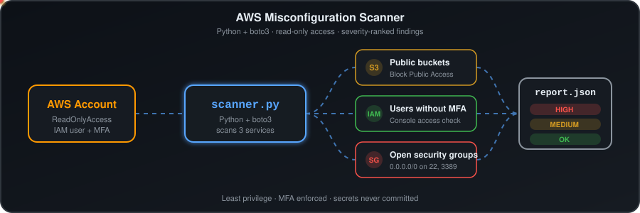

  

# Hi, I'm Sayan Mondal 👋

**Aspiring Cloud Security Engineer** | B.Tech CSE (Cyber Security), 2026
📍 Kolkata, India · Open to roles in Hyderabad

## What I'm focused on
- Securing AWS and GCP environments (IAM, misconfiguration detection, logging)
- Security automation with Python and FastAPI
- Web and network testing with Burp Suite, Nmap and Wireshark

## Projects

  

- [RAVEN](https://github.com/sayancloudsec/IOT-based-AI-agent): voice and vision AI assistant on Raspberry Pi

  

- [AWS Misconfiguration Scanner](https://github.com/sayancloudsec/AWS-misconfiguration-scanner): Python and boto3 tool that finds public S3 buckets, IAM users without MFA, and security groups open to the internet, with severity-ranked JSON reports
- Coming next: Terraform secure AWS baseline with Checkov in CI

  

- [Terraform DevSecOps Pipeline](https://github.com/sayancloudsec/terraform-devsecops-pipeline): CI pipeline that scans Terraform with Checkov on every pull request and blocks insecure changes from merging into main, using GitHub Actions and a branch ruleset
  
## Currently learning
- [e.g. Terraform, AWS Security fundamentals]

## Connect
[LinkedIn](https://www.linkedin.com/in/sayanmondalcyber/) · [mondalsayan875@gmail.com]## Hi there 👋

<!--
**SayanMondalCyber/SayanMondalCyber** is a ✨ _special_ ✨ repository because its `README.md` (this file) appears on your GitHub profile.

Here are some ideas to get you started:

- 🔭 I’m currently working on ...
- 🌱 I’m currently learning ...
- 👯 I’m looking to collaborate on ...
- 🤔 I’m looking for help with ...
- 💬 Ask me about ...
- 📫 How to reach me: ...
- 😄 Pronouns: ...
- ⚡ Fun fact: ...
-->
